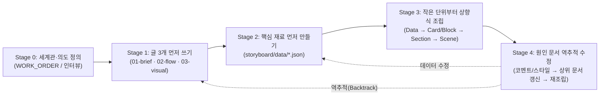

# Vanilla Studio 품질 고도화 리팩토링 계획서 — Storyboard & 3-Doc Material-First Workflow

> 문서 버전: **v1.0 (Proposed, 2026-10-18)**
> 기반 자료: `Docs/QualityControl/claude-code-website-guide.md` ("클로드 코드로 AI 티 안 나게, 해외 브랜드 퀄리티 웹사이트 만들기")
> 선행 문서: `Docs/Planning/Refactor-Spec-v2.md`, `Docs/Planning/Technical-Design.md` (v1.1), `Docs/Planning/Decisions.md` (D-034~D-036)

---

## 1. 배경 및 목표

`Docs/QualityControl/claude-code-website-guide.md`의 핵심 통찰은 **"AI 티(AI smell)는 대충 던진 지시가 만든 평균의 디자인이며, 고품질 결과물은 프롬프트 한 줄이 아니라 철저한 준비 순서(3대 문서 분리 → 핵심 재료 선행 구축 → 작은 단위부터의 상향식 조립 → 원인 문서 역추적 수정)에서 나온다"**는 점이다.

이 원리는 웹사이트뿐만 아니라 바닐라 스튜디오가 다루는 **정적 이미지(포스터/카드) · 웹 페이지 · 프레젠테이션 슬라이드 · 2D/3D 모션 그래픽** 전반에 그대로 적용된다. 본 리팩토링 계획은 다음 세 가지 축을 중심으로 바닐라 스튜디오의 UI와 에이전트 협업 파이프라인을 개편한다.

1. **스토리보드(`/storyboard`) 메뉴 신설**: 에이전트가 최종 결과물(시퀀스·신 코드)을 만들기 전에 작성하는 중간 생성물(**기획서 · 설계서 · 비주얼 디렉션 + 핵심 재료 데이터 + 조립 계획**)을 시각적으로 확인·검수하고, 초기 빈 워크스페이스에서는 **간단한 작업 지시서 작성 창** 및 **에이전트 시작 안내**를 제공하는 허브 화면.
2. **원인 문서 역추적(Root-Cause Backtracking) 수정 워크플로**: 사용자가 시퀀스/신에서 코멘트를 달거나 스타일·텍소노미를 지정할 때, 화면 코드를 즉흥적으로 덧대지 않고 **원인이 되는 상위 문서(기획서 → 설계서 → 비주얼 디렉션 → 핵심 재료 데이터)로 돌아가 먼저 갱신한 뒤 재조립**하도록 강제하는 작업 프로토콜.
3. **5단계 에이전트 생성 프로세스 & 바닐라 스튜디오 템플릿/텍소노미 접목**: 가이드 문서의 3단계 준비 과정을 바닐라 스튜디오의 내장 템플릿(15종), Opus 분해 프리셋(15종), 디자인/모션 텍소노미 사전(`glossary.json`), 컬러 팔레트(`DESIGN.md`)와 결합한 표준 작업 프로세스 수립.

---

## 2. 핵심 개념 매핑 (가이드 원리 ↔ Vanilla Studio 아키텍처)

| 가이드 핵심 원리 (`claude-code-website-guide.md`) | Vanilla Studio 리팩토링 반영 방식 |
| --- | --- |
| **1단계: 글 3개 먼저 쓰기**<br>- 기획서(목적·다룰 내용·**하지 않을 것**)<br>- 설계(시나리오·데이터 규격·컴포넌트 목록)<br>- 비주얼 디렉션(톤·빛·공통 불변 키워드 A + 개별 가변 키워드 B) | 워크스페이스 내 **`storyboard/`** 디렉터리 도입:<br>- `storyboard/01-brief.md` (기획서: 핵심 한 문장·목적·범위·**하지 않을 것**)<br>- `storyboard/02-design-flow.md` (설계서: 시퀀스/시나리오 흐름·데이터 스키마·조립 계획)<br>- `storyboard/03-visual-direction.md` (비주얼 디렉션: `DESIGN.md` 토큰 연동·공통/가변 키워드·적용 텍소노미)<br>- `storyboard/storyboard.json` (구조화 메타데이터 — 스토리보드 UI 렌더링용 진실 공급원) |
| **2단계: 핵심 재료 먼저 만들기**<br>- 컴포넌트 코드에 문구·스펙·이미지 경로 하드코딩 금지<br>- 위계(Hierarchy)가 있는 콘텐츠 데이터와 제품/항목 데이터를 먼저 분리 구축 | **`storyboard/data/`** (및 신별 공유 데이터) 도입:<br>- `storyboard/data/content.json`: 위계(Hero → Tagline → Brand Value → Section/Beat Copy)가 정의된 문구 데이터<br>- `storyboard/data/items.json`: 반복되는 카드·제품·슬라이드 항목·낮/밤/상태별 미디어 매핑 데이터<br>- `scene.json`의 `copy.items`와 자동 동기화 |
| **3단계: 작은 단위부터 조립 계획 & Storybook 관리**<br>- 데이터 → 카드 → 그리드 섹션 → 히어로/브랜드 밸류 → 페이지<br>- Storybook 상단에 기획·글·데이터·이미지를 두고 하단에 스타일·컴포넌트·섹션·페이지를 적층 | **스토리보드(`/storyboard`) 메뉴**가 Vanilla Studio의 시각적 Storybook 허브 역할 수행:<br>- 상단: **3대 기획 문서 시각 카드** (기획서·설계서·비주얼 디렉션)<br>- 중단: **핵심 재료 뷰어** (콘텐츠 위계 트리·데이터 테이블·레퍼런스/에셋)<br>- 하단: **상향식 조립 파이프라인(Assembly Plan)** (`Data` → `Unit Component` → `Section/Beat` → `Scene`) 상태 및 신 연결 |
| **수정 원칙: 원인이 되는 글로 돌아가 협의**<br>- 허전하거나 수정할 때 화면을 냅다 고치지 않고 기획서/설계서/비주얼 디렉션 중 원인 지점으로 돌아가 문서부터 업데이트 후 재조립 | **코멘트 & 스타일 변경의 Root-Cause Layer 라우팅**:<br>- 코멘트(`comments.json`) 및 작업 지시서(`WORK_ORDER.md`)에 **원인 계층(`L1:brief` \| `L2:design-flow` \| `L3:visual-direction` \| `L4:data` \| `L5:scene-polish`)** 도입<br>- 에이전트는 상위 원인 문서와 데이터를 먼저 갱신한 뒤 신 코드(`scenes/<slug>/src/`)를 수정 |
| **디자인 텍소노미 & 스타터 키트 활용**<br>- 막연한 설명 대신 `Shared Layout Animation`, `Horizontal Scroll`, `Line Grid (2:1)` 등 검증된 디자인 텍소노미 패턴과 그리드 블록 조합 | **바닐라 스튜디오 템플릿 & 텍소노미 사전 통합**:<br>- 내장 가이드 템플릿(15종) + Opus 분해 프리셋 + 용어집(`glossary.json`)에 웹/슬라이드/모션 공통 **Layout · Transition · Scroll · Theme Blending 텍소노미** 확충<br>- `pnpm vanilla taxonomy` / `pnpm vanilla templates`로 에이전트와 사용자가 동일 용어로 소통 |

---

## 3. 상세 설계 1: 스토리보드 (`/storyboard`) 메뉴 및 화면

### 3.1 네비게이션 및 라우팅 (`AppShell.tsx`, `App.tsx`)

- 좌측 사이드바(`NAV_ITEMS`) 최상단에 **스토리보드(`/storyboard`)** 메뉴를 배치하여 제작 흐름의 자연스러운 순서를 반영한다:
  1. **Storyboard (`/storyboard`)** — 중간 생성물(기획서·설계서·비주얼 디렉션·핵심 재료·조립 계획) 시각 확인 및 초기 작업 지시
  2. **Sequence (`/workspace`)** — 신 노드 그래프 및 전환(Transition) 편집
  3. **Scenes (`/scenes`)** — 개별 신 미리보기·인스펙터·코멘트·터미널
  4. **Templates (`/templates`)** — 템플릿·Opus 프리셋·팔레트·텍소노미 카탈로그
  5. **Playground (`/playground`)** — 완성 시퀀스 갤러리 및 재생
  6. **Settings (`/settings`)** — 하단 고정

### 3.2 워크스페이스 내 스토리보드 파일 계약 (`<workspace>/storyboard/`)

```text
<workspace>/
├─ storyboard/
│  ├─ storyboard.json            # ★ 스토리보드 구조화 데이터 (zod 검증, canonical 직렬화)
│  ├─ 01-brief.md                # 1. 기획서 (한 줄 정의, 목적, 다룰 내용, 하지 않을 것)
│  ├─ 02-design-flow.md          # 2. 설계서 (시나리오/시퀀스 흐름, 데이터 규격, 컴포넌트·신 조립 계획)
│  ├─ 03-visual-direction.md     # 3. 비주얼 디렉션 (무드, 빛/색온도, 공통 불변 키워드 A + 가변 속성 B, 텍소노미)
│  └─ data/
│     ├─ content.json            # 위계(Hierarchy)가 구조화된 전체 카피/문구 데이터
│     └─ items.json              # 도메인/제품/슬라이드 스펙 및 상태별(예: 낮/밤) 리소스 매핑 데이터
├─ WORK_ORDER.md                 # 사용자 초기 작업 지시서 + 변경 내역 + 코멘트 통합 문서
├─ DESIGN.md                     # 비주얼 디렉션에서 파생된 디자인 토큰 (단일 또는 다단계 테마 토큰)
├─ sequence.json                 # 설계서 조립 계획에 따라 구성된 시퀀스 그래프
└─ scenes/<slug>/                # 조립 계획의 최종 단위인 개별 신
```

#### `storyboard/storyboard.json` 스키마 초안 (v1)

```jsonc
{
  "version": 1,
  "workspaceId": "ws_01H...",
  "stage": "docs-ready", // "empty" | "briefing" | "docs-ready" | "materials-ready" | "assembling" | "completed"
  "brief": {
    "title": "2026 봄 신제품 런칭 쇼케이스",
    "oneLiner": "하루의 시간과 공간 속에 놓인 빛 상태로 제품을 만나게 하는 건축 조명 브랜드 쇼케이스",
    "mediaIntent": "web", // "web" | "image" | "slide" | "motion"
    "purpose": "스펙 나열이 아닌 시간대별 빛의 경험으로 브랜드 가치를 전달",
    "inScope": ["시간대별(낮/오후/저녁/밤) 4단계 테마 및 이미지 블렌딩", "20종 조명 제품 그리드 및 필터", "히어로 및 브랜드 밸류 섹션"],
    "nonGoals": ["복잡한 장바구니/결제 팝업", "과도한 3D 파티클 장식", "일관성 없는 다채로운 배경색"]
  },
  "designFlow": {
    "narrativeArc": "히어로(브랜드 정의) → 브랜드 밸류(3대 상징 언어) → 파노라마 무드 브릿지(시간의 흐름) → 제품 쇼케이스(필터·그리드) → 제품 상세",
    "dataSchemas": [
      { "id": "content", "path": "storyboard/data/content.json", "description": "위계별 사이트 문구 및 브랜드 카피", "itemCount": 12 },
      { "id": "items", "path": "storyboard/data/items.json", "description": "조명 제품 스펙 및 낮/밤 이미지 쌍", "itemCount": 20 }
    ],
    "assemblyPlan": [
      { "id": "asm_1", "layer": "data", "name": "제품 스펙 & 위계형 카피 데이터", "dependsOn": [], "status": "done", "targetPath": "storyboard/data/" },
      { "id": "asm_2", "layer": "component", "name": "ProductCard (낮/밤 블렌딩 카드)", "dependsOn": ["asm_1"], "taxonomy": ["time-blend-4stage"], "status": "done", "targetScene": "scn_showcase" },
      { "id": "asm_3", "layer": "section", "name": "ProductGrid & Continuity Filter", "dependsOn": ["asm_2"], "taxonomy": ["shared-layout-transition"], "status": "done", "targetScene": "scn_showcase" },
      { "id": "asm_4", "layer": "section", "name": "Hero (2:1 Line Grid) & Brand Value Cards", "dependsOn": ["asm_1"], "taxonomy": ["line-grid-2to1"], "status": "done", "targetScene": "scn_hero" },
      { "id": "asm_5", "layer": "section", "name": "Elevation & Horizontal Scroll Panorama Bridge", "dependsOn": ["asm_4", "asm_3"], "taxonomy": ["horizontal-scroll-panorama"], "status": "draft", "targetScene": "scn_bridge" }
    ]
  },
  "visualDirection": {
    "moodKeywords": ["minimal-architectural", "warm-monochrome", "3800k-glow", "continuity"],
    "paletteId": "editorial-warm",
    "themeStages": [
      { "id": "noon", "label": "12:00 Day", "dayWeight": 1.0, "nightWeight": 0.0, "canvasToken": "#F4F1EA" },
      { "id": "afternoon", "label": "16:00 Warm", "dayWeight": 0.75, "nightWeight": 0.25, "canvasToken": "#C8C2B8" },
      { "id": "evening", "label": "20:00 Dusk", "dayWeight": 0.25, "nightWeight": 0.75, "canvasToken": "#4A4640" },
      { "id": "night", "label": "24:00 Night", "dayWeight": 0.05, "nightWeight": 0.95, "canvasToken": "#181715" }
    ],
    "invariants": ["무광 검정 알루미늄 프레임", "화이트 프로스티드 글래스 재질", "3800K 색온도", "전면 정면 구도와 균일 여백"],
    "variables": ["제품별 외형 실루엣", "설치 방식(펜던트/월/플로어)", "치수 및 루멘 스펙"],
    "selectedTemplate": "opus-interactive-hero@1",
    "selectedTaxonomy": ["line-grid-2to1", "shared-layout-transition", "horizontal-scroll-panorama", "time-blend-4stage"]
  }
}
```

### 3.3 스토리보드 화면의 2가지 상태 (Empty vs Populated)

#### 상태 1: 문서 미작성 시 — "초기 작업 지시서(Initial Brief) 작성 & 에이전트 시작 안내"
현재 열려 있는 워크스페이스에 `storyboard/storyboard.json`이나 3대 문서(`01-brief.md` 등)가 아직 없다면, 빈 화면 대신 **사용자가 바로 의도를 적어 넣거나 에이전트를 호출할 수 있는 온보딩 워크스테이션**을 보여준다.

1. **간단한 작업 지시서 작성 폼 (Quick Brief Composer)**:
   - **필수 입력**: 작업 타이틀(`brief.title`) · **매체 의도 선택**(`웹 페이지(Web)` · `정적 이미지/포스터(Image)` · `슬라이드/덱(Slide)` · `모션/3D 애니메이션(Motion)`) · **핵심 한 문장**(한 줄 컨셉, 예) *"하루 빛의 흐름을 보여주는 건축 조명 브랜드 쇼케이스"*). 비어 있으면 저장하지 않고 필수 오류를 표시한다.
   - **고급(접기/펼치기)**: 목적 · **꼭 포함할 내용 & 하지 않을 것(Non-Goals)**(AI 티를 빼기 위해 피하고 싶은 요소나 집중할 목적을 간단히 메모).
   - **추천 템플릿·팔레트 빠른 선택(선택 사항)**: 입력 키워드 기반으로 `recommend.ts`가 추천하는 내장 템플릿/팔레트 미리보기 카드 제시
   - **[작업 지시서 저장 (`WORK_ORDER.md` 생성)]** 버튼 클릭 시:
     - `storyboard/storyboard.json` (`stage: "briefing"`, 설계·비주얼은 기존 값 병합 보존) · `storyboard/01-brief.md`(타이틀 포함) · `WORK_ORDER.md`에 초기 지시서가 기록된다. 자리 표시자 문서(`02-design-flow.md` · `03-visual-direction.md` · `data/*.json`)는 없을 때만 만들고 이미 있으면 덮어쓰지 않는다.
     - **화면을 닫지 않는다**: 에이전트가 3대 문서·핵심 재료·시퀀스·신 중 하나라도 만들기 시작했다는 신호(단계 전진 · 자리 표시자와 달라진 문서 · `assemblyPlan`/`dataSchemas` · `sequence.json` · `scenes/`)를 받기 전까지 온보딩 화면을 유지하고, 그 전까지는 입력값을 고쳐 다시 저장할 수 있다. 신호를 받으면 스토리보드 보드 화면으로 넘어간다.
2. **에이전트로 작업 시작하기 안내 패널 (Agent Launchpad)**:
   - **방식 A (외부 에이전트로 폴더 열기 안내)**: 워크스페이스 폴더 경로 원클릭 복사 + Claude Code / Codex / Cursor 등에서 해당 폴더를 열고 붙여넣을 **표준 시작 프롬프트(`"WORK_ORDER.md와 AGENTS.md를 읽고 1단계: 기획서·설계서·비주얼 디렉션 3개 문서와 스토리보드부터 작성해 줘"`)** 복사 버튼.
   - **방식 B (내장 터미널에서 에이전트 바로 실행)**: 등록된 기본 에이전트 CLI를 워크스페이스 루트(`cwd`)에서 바로 띄우고 시작 프롬프트를 클립보드에 전달.

#### 상태 2: 문서 작성 완료/진행 중 — "중간 생성물 시각적 스토리보드 보드"
에이전트가 3대 문서와 핵심 재료를 작성하면 파일 감시(`watch.rs`)를 통해 즉시 **시각적 스토리보드 대시보드**로 전환된다.

1. **상단 진행 상태 바 & 액션**:
   - 단계 표시: `① 3대 기획 문서` → `② 핵심 재료(Data)` → `③ 상향식 조립(Components → Scenes)` → `④ 시퀀스 완성`
   - 우측 버튼: `[스토리보드 코멘트 추가]` · `[작업 지시서(WORK_ORDER.md) 보기]` · `[프롬프트 복사]`
2. **섹션 1: 3대 문서 시각 카드 (Three Pillar Cards)**:
   - **기획서 카드 (`01-brief.md`)**: 한 줄 핵심 정의(대형 타이포), 목적, `다룰 내용(In-Scope)` vs `하지 않을 것(Non-Goals)` 대비 배지 리스트, 마크다운 원문 열람/편집 모달.
   - **설계서 카드 (`02-design-flow.md`)**: 서사/UX 시나리오 흐름도(Mermaid 또는 스텝 체인), 분리된 데이터 스키마 목록, 컴포넌트 명세, 마크다운 원문 열람.
   - **비주얼 디렉션 카드 (`03-visual-direction.md`)**: `DESIGN.md` 연동 컬러 스와치(단일 또는 시간대별 4단계 테마 스와치), 무드 키워드, **불변 키워드(A: 공통 규칙) vs 가변 키워드(B: 개별 속성)** 매트릭스, 선택된 디자인 텍소노미 배지(미리보기 이미지·데모 링크 툴팁 포함).
3. **섹션 2: 핵심 재료 프리뷰어 (Core Materials Viewer)**:
   - **콘텐츠 문구 위계(`content.json`)**: 책의 목차처럼 위계(Hero → Tagline → Brand Value 1·2·3 → Section Copy)가 시각화된 카드 트리. 문구가 레이아웃을 어떻게 결정하는지 한눈에 확인.
   - **도메인/아이템 데이터(`items.json`)**: 제품/슬라이드/장면별 스펙 테이블과 매핑된 에셋(낮/밤 이미지 쌍 등) 그리드 미리보기.
4. **섹션 3: 상향식 조립 계획 보드 (Bottom-Up Assembly Pipeline)**:
   - `Data(데이터)` → `Component(단위 카드/위젯)` → `Section/Beat(그리드/히어로/브릿지 섹션)` → `Scene(신)`으로 이어지는 조립 블록을 단계별로 시각화.
   - 각 조립 블록마다 적용된 **텍소노미 태그**(예: `line-grid-2to1`, `horizontal-scroll-panorama`), 상태(`planned`/`draft`/`done`), 연결된 신(`scenes/<slug>`) 미리보기 썸네일 및 `[신 화면으로 이동]` 링크 표시.

---

## 4. 상세 설계 2: 코멘트·스타일 지정 시 "원인 문서 역추적" 프로토콜

가이드에서 강조한 **"화면 직접 수정 대신 원인이 되는 글로 돌아가 협의하고 그 지점부터 다시 올바른 순서를 밟는다"**는 원칙을 바닐라 스튜디오의 코멘트(`comments.json`) 및 작업 지시서(`WORK_ORDER.md`) 시스템에 내장한다.

### 4.1 코멘트 및 스타일 변경의 원인 계층(`rootCause`) 모델링

사용자가 스토리보드(`/storyboard`), 시퀀스(`/workspace`), 신(`/scenes`)에서 코멘트를 달거나 인스펙터/템플릿 화면에서 스타일·텍소노미를 지정할 때, 변경 요구사항을 5개 원인 계층으로 분류한다:

| 계층 ID | 명칭 | 해당되는 요구사항 예시 | 에이전트가 먼저 수정해야 할 원본 파일 (역추적 시작점) |
| --- | --- | --- | --- |
| **`brief`** | **L1. 기획·스토리텔링** | "히어로와 제품 섹션 사이에 브랜드 스토리텔링이 증발된 느낌이다. 중간 브릿지 메시지를 넣자" | `storyboard/01-brief.md` → `02-design-flow.md` → `data/` → `scenes/` |
| **`design-flow`** | **L2. 설계·구조·조립** | "제품 필터링 후 상세 페이지로 갈 때 구성을 바꾸고 싶다", "가로 스크롤 파노라마 섹션을 추가하자" | `storyboard/02-design-flow.md` (`assemblyPlan`) → `sequence.json` / `scene.json` → `scenes/` |
| **`visual-direction`** | **L3. 비주얼 디렉션·텍소노미** | "시간대에 따라 낮/밤 4단계로 배경과 이미지를 블렌딩하자", "공유 레이아웃 애니메이션(`shared-layout-transition`)을 적용하자", 팔레트 변경 | `storyboard/03-visual-direction.md` & `DESIGN.md` → `scene.json` (`visualStyle`/`motionVocabulary`) → `scenes/` |
| **`materials`** | **L4. 핵심 재료(데이터·문구)** | "브랜드 밸류 3번째 문구를 수정하자", "제품 스펙 데이터를 추가하자" | `storyboard/data/content.json` 또는 `items.json` (`scene.json.copy`) — **컴포넌트 코드는 건드리지 않고 데이터만 갱신** |
| **`scene-polish`** | **L5. 개별 신 미세 조정** | "타이틀 폰트 크기를 살짝 줄이고 등장 타이밍을 0.2초 앞당기자" | `scenes/<slug>/params/*.values.json` 또는 `scenes/<slug>/src/` |

### 4.2 UI 지원: 코멘트 툴박스 & 스타일/텍소노미 지정기 확장

1. **`CommentToolbox.tsx` 확장**:
   - 코멘트 입력 시 **대상 계층(Target Layer) 선택 칩**(기본값 `자동/에이전트 판단(auto)` 또는 `기획(brief)` · `설계/구조(design-flow)` · `비주얼/스타일(visual-direction)` · `문구/데이터(materials)` · `화면 미세조정(scene-polish)`)과 **원하는 디자인 텍소노미/템플릿 태그 첨부 기능**을 제공한다.
2. **시퀀스/신 스타일 빠른 지정 → 역추적 Work Order 생성**:
   - 사용자가 신 인스펙터나 템플릿 메뉴에서 특정 스타일(팔레트, 무드, 혹은 `horizontal-scroll-panorama`, `shared-layout-transition` 등 기법)을 신/시퀀스에 지정하면, `recordStudioChange`가 `WORK_ORDER.md`에 아래와 같이 **역추적 실행 절차(Backtracking Checklist)**를 자동 생성한다:
     ```markdown
     - **[chg_...]** [visual-direction → scene] `scenes/bridge` (브릿지 신)
       - 사용자 요청: 가로 스크롤 파노라마(`horizontal-scroll-panorama`) 및 4단계 시간 블렌딩 스타일 적용
       - 필수 작업 순서 (Root-Cause Workflow):
         1. [ ] `storyboard/03-visual-direction.md` 및 ` storyboard/02-design-flow.md`에 해당 섹션의 시각/흐름 규칙 먼저 반영
         2. [ ] 필요한 핵심 재료(`storyboard/data/content.json`, `items.json`) 보강
         3. [ ] `scenes/bridge/scene.json` 갱신 및 `pnpm vanilla sync-guides bridge` 실행
         4. [ ] `scenes/bridge/src/` 컴포넌트 조립 및 `pnpm check:scene` 검증
     ```

---

## 5. 상세 설계 3: 에이전트 생성 프로세스 개편 및 템플릿/텍소노미 접목

### 5.1 에이전트 5단계 표준 작업 프로세스 (`AGENTS.md` · `VANILLA_GUIDE.md` · `pnpm vanilla`)

기존 D-036의 3단계(인터뷰 → 드래프트 → 수정)를 가이드 문서의 방법론에 맞춰 **5단계 파이프라인**으로 개편한다.



1. **Stage 0 — 세계관 & 의도 좁히기 (Worldview & Intent)**:
   - 사용자의 짧은 요청이나 `WORK_ORDER.md`의 초기 지시서를 읽고, 프로젝트의 핵심 가치를 **단 한 문장(`oneLiner`)**으로 정의한다.
   - `pnpm vanilla templates --intent <web|image|slide|motion>` 및 `pnpm vanilla taxonomy`를 실행해 바닐라 스튜디오가 보유한 최적의 템플릿·Opus 프리셋·디자인 텍소노미를 선정한다.
2. **Stage 1 — 글 3개 먼저 쓰기 (3 Documents First)**:
   - 코딩을 시작하기 전에 반드시 `pnpm vanilla init-storyboard`(또는 파일 생성)로 `storyboard/01-brief.md`(기획서), `storyboard/02-design-flow.md`(설계서), `storyboard/03-visual-direction.md`(비주얼 디렉션), `storyboard/storyboard.json`, `DESIGN.md`를 먼저 작성한다.
   - 이때 기획서에는 **하지 않을 것(Non-Goals)**을 명시하고, 비주얼 디렉션에는 **공통 불변 키워드(A)와 개별 가변 속성(B)**을 분리 정의한다.
3. **Stage 2 — 핵심 재료 먼저 만들기 (Core Materials First)**:
   - UI 컴포넌트를 만들기 전에 `storyboard/data/content.json`(위계형 문구 데이터)과 `storyboard/data/items.json`(도메인/스펙/에셋 매핑 데이터)을 먼저 구축한다.
   - 각 신의 `scene.json`에도 `copy.items`(불변 원문 카피)를 동기화한다.
4. **Stage 3 — 작은 단위부터 상향식 조립 (Bottom-Up Assembly)**:
   - `02-design-flow.md`의 `assemblyPlan` 순서에 따라 **가장 작은 단위부터 조립**한다:
     1. 데이터 바인딩 타입/훅 준비 (`storyboard/data/` 참조, 컴포넌트 내 텍스트/데이터 하드코딩 절대 금지)
     2. 최소 단위 UI 컴포넌트 조립 (예: `ProductCard`, `BrandValueCard`, `MetricBadge`)
     3. 스타터 그리드/레이아웃 템플릿(예: `LineGrid 2:1`, `BentoGrid`, `ContinuityFilter`)과 결합해 섹션/비트 조립
     4. 섹션/비트를 이어 신(`scenes/<slug>/src/`)과 시퀀스(`sequence.json`) 완성 및 `pnpm check:scene` 검증
5. **Stage 4 — 원인 문서 역추적 기반 수정 (Root-Cause Iteration)**:
   - 사용자가 스토리보드·시퀀스·신에서 코멘트를 남기거나 스타일을 변경하면, `pnpm vanilla work-order`로 확인한 뒤 **원인이 되는 상위 문서(`01` / `02` / `03`)와 데이터(`data/*.json`)를 먼저 수정**하고, 그 변경이 하위 컴포넌트와 신 코드로 흐르게 한다.

### 5.2 바닐라 스튜디오 템플릿 & 디자인 텍소노미(Taxonomy) 접목 방안

가이드에서 소개된 **"Vibe Design Lab 텍소노미(분류 체계) + 스타터 키트 그리드"**를 바닐라 스튜디오 자산과 결합한다.

1. **디자인·레이아웃·인터랙션 텍소노미 카탈로그 확장 (`resources/glossary/*.json` & `opus-catalog.json`)**:
   - 기존 모션/3D 용어집에 더해, 웹/슬라이드/정적 이미지/모션 전반에서 에이전트에게 정확한 구현 의도를 전달하는 핵심 텍소노미 항목을 표준화한다:
     - **Layout & Starter Grid Taxonomy**:
       - `line-grid-2to1`: 보더 라인으로 구획된 2:1 비대칭 에디토리얼 그리드 (스타터 키트 핵심 그리드)
       - `hierarchy-driven-hero`: 콘텐츠 위계(메인 타이틀 + 3대 상징 밸류 카드)에서 레이아웃이 자연 도출되는 히어로 구조
       - `continuity-filter-grid`: 필터 전환 시 요소가 갑자기 사라지지 않고 연속성을 유지하며 재배치되는 그리드
     - **Transition & Scroll Taxonomy**:
       - `shared-layout-transition`: 목록 카드에서 상세 화면/다음 스텝으로 이동할 때 이미지·요소가 끊기지 않고 그대로 이동·확장되는 공유 레이아웃 전환 (Framer Motion `layoutId` / FLIP 패턴)
       - `horizontal-scroll-panorama`: 세로 스크롤 중 파노라마 이미지/스토리라인이 가로로 흐르며 서사적 브릿지 역할을 하는 섹션
     - **Theme & Material Blending Taxonomy**:
       - `time-blend-4stage`: 단일 다크/라이트가 아니라 시간대·상태(예: 12시/16시/20시/24시 4단계)에 따라 이미지 오파시티 블렌딩 비율과 배경 디자인 토큰(`DESIGN.md`)이 동기화되어 변하는 연출
       - `invariant-variant-matrix`: 브랜드 공통 불변 속성(재질·조명·구도·여백)과 아이템별 가변 속성(형태·스펙)을 분리해 일관된 톤을 유지하는 규칙
2. **`pnpm vanilla` 에이전트 브리지 명령 확장 (`scripts/vanilla-agent.mjs`)**:
   - `pnpm vanilla storyboard`: 현재 스토리보드 상태(`stage`), 3대 문서 요약, 핵심 재료 데이터 현황, 조립 계획(`assemblyPlan`) 출력.
   - `pnpm vanilla init-storyboard`: 워크스페이스에 `storyboard/` 폴더(`storyboard.json`, `01-brief.md`, `02-design-flow.md`, `03-visual-direction.md`, `data/content.json`, `data/items.json`) 스캐폴딩 생성.
   - `pnpm vanilla taxonomy [--category layout|transition|scroll|theme|motion] [--query <keyword>]`: 사용자의 모호한 연출 아이디어를 정확한 디자인 텍소노미 ID와 구현 힌트(`implementationHint`)로 매핑.
3. **`check:scene` 품질 검사기 보강 (`scripts/check-scene-core.mjs`)**:
   - 기존 시간 결정성(`useTime`)·색상 토큰(`var(--color-*)`) 검사에 더해, **데이터 하드코딩 방지 권장 검사**(스토리보드 데이터가 존재할 때 문구 원문 일치 및 데이터 분리 여부 점검)와 **3대 문서-신 가이드 정합성 체크**를 추가한다.

---

## 6. 단계별 구현 작업 계획 (Milestones & TODO)

리팩토링은 기존 기능을 깨뜨리지 않고 점진적으로 검증할 수 있도록 **4개 작업 묶음(Wave S1 ~ S4)**으로 나누어 진행한다.

### Wave S1: 스토리보드 데이터 계약 및 에이전트 프로세스 뼈대 (`feat/storyboard-workflow`)
- **S1.1 `storyboard.json` 스키마 및 파일 입출력 모듈 (`src/lib/storyboard/`)**
  - 대상: `src/lib/storyboard/schema.ts`, `src/lib/storyboard/files.ts`, `src/lib/storyboard/schema.test.ts`
  - 내용: `storyboard.json` zod 스키마(`stage`, `brief`, `designFlow`, `visualDirection`, `assemblyPlan`), canonical 직렬화, `01-brief.md`·`02-design-flow.md`·`03-visual-direction.md`·`data/content.json`·`data/items.json` 읽기/쓰기 헬퍼 구현.
  - 완료 판정: 유효·무효 스키마 단위 테스트 및 canonical 왕복 테스트 통과.
- **S1.2 디자인 텍소노미 확장 (`resources/glossary/`, `resources/opus/opus-catalog.json`)**
  - 대상: `resources/glossary/static.json`, `resources/glossary/motion.json`, `resources/opus/opus-catalog.json`
  - 내용: 가이드 문서의 핵심 패턴(`line-grid-2to1`, `hierarchy-driven-hero`, `continuity-filter-grid`, `shared-layout-transition`, `horizontal-scroll-panorama`, `time-blend-4stage`, `invariant-variant-matrix`)과 `implementationHint` 추가.
  - 완료 판정: 용어집·카탈로그 스키마 검증 테스트 통과.
- **S1.3 `pnpm vanilla` CLI 브리지 및 워크스페이스 템플릿 지침 개편**
  - 대상: `resources/workspace-template/scripts/vanilla-agent.mjs`, `resources/workspace-template/AGENTS.md`, `resources/workspace-template/VANILLA_GUIDE.md`, `src/lib/guides/agentsMd.ts`
  - 내용:
    - `pnpm vanilla storyboard`, `pnpm vanilla init-storyboard`, `pnpm vanilla taxonomy` 명령 추가.
    - 루트 `AGENTS.md`와 `VANILLA_GUIDE.md`를 **5단계 생성 프로세스(세계관 → 3대 문서 → 핵심 재료 → 상향식 조립 → 원인 문서 역추적 수정)** 기준으로 개편.
  - 완료 판정: CLI 명령 단위 테스트 및 가이드 렌더 스냅샷 테스트 통과.

### Wave S2: 스토리보드(`/storyboard`) 메뉴 및 화면 구현
- **S2.1 사이드바 네비게이션 및 라우트 추가**
  - 대상: `src/components/layout/AppShell.tsx`, `src/App.tsx`, `src/lib/i18n/dictionaries/{ko,en}.ts`
  - 내용: 좌측 사이드바에 `Storyboard` (`/storyboard`) 메뉴 추가, 한/영 다국어 키 등록.
  - 완료 판정: 라우팅 및 네비게이션 렌더링 테스트 통과.
- **S2.2 초기 상태(문서 미작성) — 간단 작업 지시서 작성 창 & 에이전트 시작 안내 (`StoryboardOnboarding.tsx`)**
  - 대상: `src/components/storyboard/StoryboardOnboarding.tsx`
  - 내용:
    - 작업 타이틀·매체 의도(`web`/`image`/`slide`/`motion`)·핵심 한 줄은 필수 입력, 목적·다룰 내용·하지 않을 것(Non-Goals)은 고급(접기/펼치기) 폼.
    - 저장 시 `WORK_ORDER.md`(타이틀 포함) 및 `storyboard/storyboard.json`(`stage: "briefing"`, 01-brief 타이틀 포함) 생성. 자리 표시자 문서·데이터는 없을 때만 만들고 덮어쓰지 않는다.
    - 저장 후에도 화면을 닫지 않고 에이전트 시작 신호(단계 전진·문서 갱신·시퀀스·신 생성)를 감시하다 신호가 오면 스토리보드 보드로 전환. 신호 전에는 재편집·재저장 가능.
    - 에이전트로 폴더 열어 작업 시작하기 안내(클립보드 시작 프롬프트 복사 + 내장 터미널 에이전트 실행 연동).
  - 완료 판정: 폼 작성 → `WORK_ORDER.md` 생성 및 프롬프트 복사, 필수 검증·고급 접기·저장 후 화면 유지·재저장·에이전트 시작 전환 컴포넌트 테스트 통과.
- **S2.3 중간 생성물 시각 보드 UI (`src/pages/Storyboard.tsx`, `src/components/storyboard/*`)**
  - 대상: `src/pages/Storyboard.tsx`, `src/components/storyboard/ThreePillarCards.tsx`, `src/components/storyboard/MaterialsViewer.tsx`, `src/components/storyboard/AssemblyPipeline.tsx`
  - 내용:
    - 1층: 기획서(`01-brief.md`) · 설계서(`02-design-flow.md`) · 비주얼 디렉션(`03-visual-direction.md`) 시각 카드 + 원문 마크다운 뷰어/편집기.
    - 2층: 핵심 재료(`data/content.json` 문구 위계 트리, `data/items.json` 스펙/에셋 테이블) 시각 뷰어.
    - 3층: 상향식 조립 파이프라인(`Data → Component → Section → Scene`) 진행 상태 및 신 화면 점프 링크.
  - 완료 판정: 빈 상태 ↔ 문서 존재 상태 전환 테스트 및 시각 보드 렌더링 테스트 통과.

### Wave S3: 코멘트 & 스타일 지정의 "원인 문서 역추적" 연동
- **S3.1 코멘트(`comments.json`) 및 작업 지시서(`workOrder.ts`) 스키마에 원인 계층(`rootCause`) 및 텍소노미 태그 추가**
  - 대상: `src/lib/scene/comments.ts`, `src/lib/workspace/workOrder.ts`, 관련 테스트
  - 내용:
    - 코멘트 및 스튜디오 변경 항목에 `layer?: 'auto' | 'brief' | 'design-flow' | 'visual-direction' | 'materials' | 'scene-polish'` 및 `taxonomyTags?: string[]` 선택 필드 추가(하위 호환 완벽 유지).
    - `renderWorkOrderMarkdown()`이 각 요청 항목마다 **원인 문서 역추적 체크리스트(어느 문서부터 수정하고 조립할지)**를 생성하도록 고도화.
  - 완료 판정: `comments.test.ts` 및 `workOrder.test.ts` 단위 테스트 통과.
- **S3.2 코멘트 툴박스(`CommentToolbox.tsx`) 및 스타일/템플릿 적용 UI 연동**
  - 대상: `src/components/comments/CommentToolbox.tsx`, `src/pages/Templates.tsx`, `src/components/inspector/SceneInspector.tsx`
  - 내용:
    - 코멘트 작성 시 원인 계층(기획/설계/비주얼/재료/신) 배지 선택 및 원하는 텍소노미 패턴 첨부 UI 추가.
    - 시퀀스/신/템플릿 화면에서 스타일이나 텍소노미 프리셋을 지정할 때 `WORK_ORDER.md`에 역추적 작업 지시가 자동 기록되도록 연결.
  - 완료 판정: UI 인터랙션 및 `WORK_ORDER.md` 반영 테스트 통과.

### Wave S4: 통합 검증 및 문서/Wiki 동기화
- **S4.1 샘플 스토리보드 데이터셋 및 E2E 흐름 검증**
  - 대상: `tests/` 통합 테스트, 샘플 워크스페이스 검증
  - 내용: 초기 지시서 작성 → 에이전트(`pnpm vanilla init-storyboard`) 3대 문서·재료 생성 → 스토리보드 화면 시각 확인 → 코멘트/스타일 역추적 지시(`WORK_ORDER.md`) → `pnpm vanilla resolve` 전체 사이클 자동화 테스트.
- **S4.2 설계 문서(`Technical-Design.md`, `Decisions.md` D-037) 및 Wiki 동기화**
  - 대상: `Docs/Planning/Decisions.md`, `Docs/Planning/Technical-Design.md`, `wiki/sources/decisions.md`, `wiki/index.md`, `wiki/log.md`
  - 완료 판정: `pnpm lint`, `pnpm typecheck`, `pnpm test`, `python .claude/skills/llm-wiki/scripts/lint.py --save` (orphans·broken links 0) 모두 통과.

---

## 7. 검증 기준 (Definition of Done)

- `pnpm typecheck` (`tsc --noEmit`) 오류 0건
- `pnpm lint` (`eslint . --max-warnings=0`) 경고·오류 0건
- `pnpm test` (`vitest run`) 전체 테스트 통과
- 모든 신규 UI 문구는 `src/lib/i18n/dictionaries/ko.ts` 및 `en.ts`에 동시 등록 (`t('...')` 사용, 하드코딩 금지)
- 모든 색상은 `DESIGN.md` 시맨틱 토큰 클래스만 사용 (원시 팔레트 클래스 금지)
